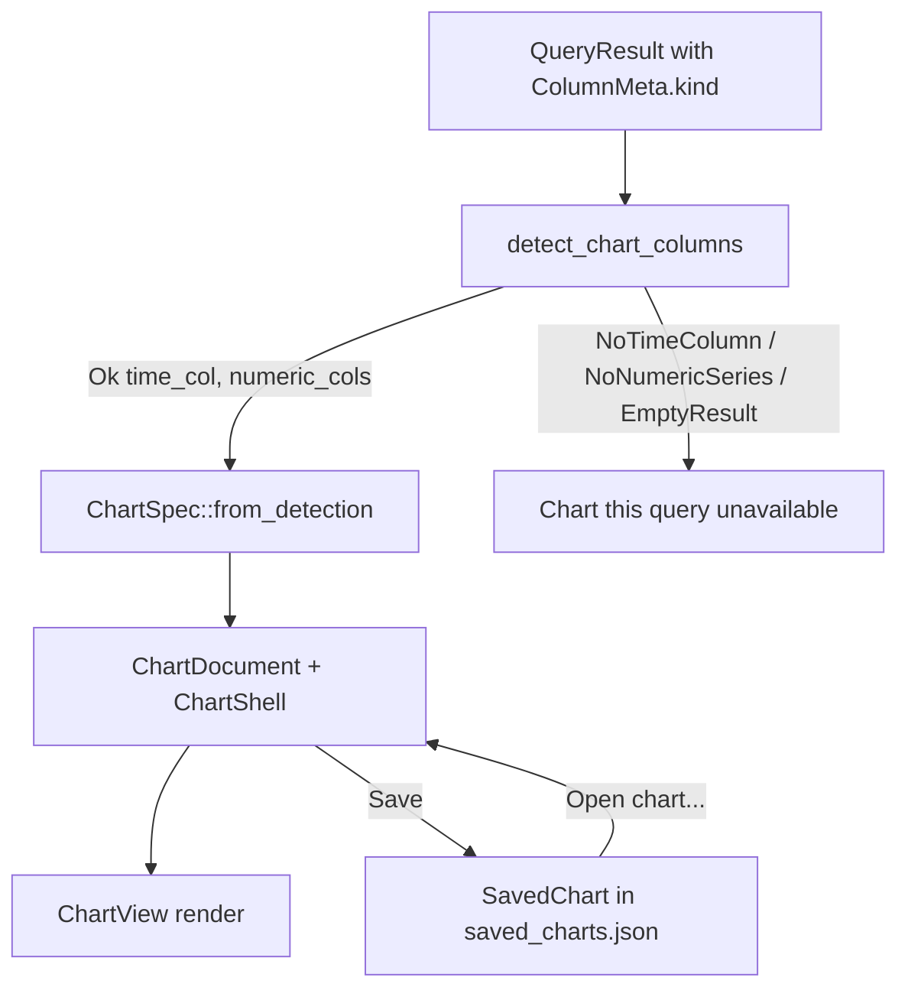

# DBFlux Charting

DBFlux can turn a query result into a chart. The charting engine is fully
driver-agnostic: it inspects only the structured column metadata that every
driver populates, never a driver identifier or a database-specific type-name
string. This document describes the supported chart types, how the engine
auto-detects axes, how charts are persisted, and how a chart is created from
the UI.

For dashboards (grids of saved charts with a shared time range), the
visualization storage tables (`viz_*`), and the driver seams for
importing/browsing upstream dashboards, see [`DASHBOARDS.md`](./DASHBOARDS.md).

## Overview

The chart engine lives in the `dbflux_components` crate under
`crates/dbflux_components/src/chart/`. Its `mod.rs` describes the full
pipeline:

1. `detect` — auto-detects suitable columns from a `QueryResult` using
   `ColumnKind` semantics only.
2. `spec` — chart and series specification types, plus constructors for
   detection-driven and manual column selection.
3. `decimate` — LTTB (Largest-Triangle-Three-Buckets) downsampling to keep
   painting fast on large datasets.
4. `axis` — tick generation and label formatting for numeric and time axes.
5. `legend` — element factory for the legend row.
6. `engine` — `ChartView`, the GPUI entity that owns chart state and renders
   the canvas.

The standalone chart document UI lives in
`crates/dbflux_ui_document/src/chart_document/` (`mod.rs`, `render.rs`,
`pane.rs`). A `ChartDocument` owns a query, a connection, a chart spec, and a
`ChartShell`, and hosts its rendering through the shared `ResultPanel` chrome
in `crates/dbflux_components/src/result_panel/`.

## Chart types

Chart kinds are defined by the `ChartKind` enum in
`crates/dbflux_components/src/chart/spec.rs`:

| Variant | Description |
|---------|-------------|
| `Line` | Line chart. The default kind (`#[default]`); also the kind chosen by every `ChartSpec` constructor. |
| `Bar` | Bar chart. |
| `Scatter` | Scatter chart. |
| `Area` | Filled line chart; the area between the series line and the baseline is shaded. Shares Line's geometry and hover behaviour. |
| `StackedBar` | Stacked vertical bars. Each X position shows one bar per series, stacked cumulatively rather than grouped side-by-side. Series are aligned on their X values: a series with no value at an X adds nothing to that bar. The Y axis is re-scaled at render time to run from zero to the maximum stack sum, and the tick labels use that same range. |
| `Pie` | Pie chart. No X/Y axes; each visible series becomes one wedge sized by the sum of that series' Y values. |

`ChartKind` carries `#[serde(default)]` semantics on the containing
`ChartSpec.kind` field, so serialized chart specs that predate the `kind` field
deserialize to `Line`.

## ColumnKind and axis auto-detection

### ColumnKind

Auto-detection is driven entirely by the `ColumnKind` enum defined in
`crates/dbflux_core/src/query/types.rs`:

| Variant | Meaning |
|---------|---------|
| `Timestamp` | A date/time or timestamp column. |
| `Float` | A floating-point numeric column. |
| `Integer` | An integer numeric column. |
| `Text` | A text/string column. |
| `Unknown` | The driver could not classify this column. |

Each driver is responsible for setting `ColumnMeta::kind` on every column it
returns (see the "Adding a New Driver" rules in `AGENTS.md`). Columns left as
`Unknown` are never used as chart axes or series.

### Auto-detection rules

`detect_chart_columns` in `crates/dbflux_components/src/chart/detect.rs` applies
these rules, in order, to a `QueryResult`:

1. If the result has zero rows, return `EmptyResult`.
2. Pick the leftmost column with `kind == Timestamp` as the X axis. If none
   exists, return `NoTimeColumn`.
3. Collect every other column with `kind == Float` or `kind == Integer`, in
   column order, as the numeric Y series. If none remain, return
   `NoNumericSeries`.
4. Otherwise return `Ok { time_col, numeric_cols }`.

The outcome is the `ChartDetection` enum, whose variants are `Ok`,
`NoTimeColumn`, `NoNumericSeries`, and `EmptyResult`.

Detection reports every numeric column, and the Y picker lists them all. Until
the user picks, `default_series_columns` draws only the measures: it leaves out
a primary key and an integer column that strictly grows or shrinks over the
rows, as a key does in a table's own order, and prefers floats when there are
any. A growing integer that is the only numeric column is drawn after all, and
a result with nothing but primary keys draws nothing until a Y column is picked.

With no time column the X axis defaults to the first numeric column, and picking
a Y column draws the chart on a numeric axis. While a chart cannot draw, its
area says why and what to do next: pick a Y column, change the query to return a
numeric column, or that the query returned no rows or failed.

In a short or narrow area, Y labels that would touch are left out. Under a plot of
40 by 60 px the area says *Too small to draw* in place of the plot, with no hover or
keyboard point, until it has room again.

### Why `type_name` and driver IDs are never inspected

The module-level documentation in `detect.rs` states that the detection module
is the boundary between the query-result model and the chart engine, and that it
inspects `ColumnKind` values — never `type_name` strings or driver identifiers.
The `detect_chart_columns` function reads only `column.kind`; it never reads
`column.type_name`, `column.name`, or any driver ID. This keeps the engine
fully decoupled from specific drivers, matching the driver/UI decoupling rule in
`AGENTS.md`: a driver makes its columns chartable purely by classifying them
with the correct `ColumnKind`.

Because `Unknown` is neither `Timestamp` nor `Float`/`Integer`, an unclassified
column can be neither an auto-detected X axis nor an auto-detected series. This
is intentional: it forces drivers to classify columns rather than letting the
engine guess from type strings.

### Axis-kind inference

When a `ChartSpec` is built, the X axis kind is inferred from the X column's
`ColumnKind`: `Timestamp` maps to `AxisKind::Time` (ticks formatted as
dates/times), everything else maps to `AxisKind::Numeric` (decimal ticks). The
`AxisSpec.unit` field is currently always `None`; it is a forward-compatibility
seam for future driver-supplied unit metadata.

### Numeric value extraction

When the engine extracts a numeric value from a cell (`extract_f64` in
`engine.rs`), it handles several `Value` shapes:

- `Value::Int` → cast to `f64`.
- `Value::Float` → used directly when finite; non-finite values are dropped.
- `Value::Decimal` (stored as a string to preserve precision) → parsed lossily
  to `f64`, dropping non-finite or unparseable values. Drivers that classify
  `NUMERIC`/`DECIMAL` columns as `ColumnKind::Float` (for example PostgreSQL
  `NUMERIC`, MSSQL `DECIMAL`) flow through this path.
- `Value::Bool` → `true` maps to `1.0`, `false` to `0.0`, so `BIT`/`BOOLEAN`
  columns that some drivers classify as `Integer` (for example MSSQL `BIT`)
  remain plottable.
- `Value::Text` is parsed only for the time axis, as an RFC 3339 timestamp.
- `Value::Null` and all other shapes yield no value.

## Saved charts

A persisted chart is a `SavedChart` record, defined in
`crates/dbflux_components/src/saved_chart.rs`. Saved charts are stored in the
unified SQLite database — the `viz_saved_charts` table and its related
`viz_saved_chart_*` tables — through `SavedChartsRepository`, with an in-memory
cache managed by `SavedChartManager`
(`crates/dbflux_ui_base/src/saved_chart_manager.rs`). Writes go to the
repository first; the cache updates only on success.

A `SavedChart` persists:

- `id`, `name`, `profile_id` — identity, display name, and owning connection
  profile.
- `source` — a `SavedChartSource`, either `Query { query }` (a query string
  executed inside a `ChartDocument`) or `Collection { collection_ref,
  time_window }` (a collection-browse source).
- `context`: where a `Query` source runs, a `SavedChartContext`; see
  [Saving](#saving).
- `chart_spec` and `bindings` — the full rendering configuration (`ChartSpec`
  and `BindingSpec`).
- `time_range_preset`, `refresh_policy`, `created_at`, `updated_at`.

Only the query string (or collection reference) is persisted; raw result data
is never stored.

### Opening a saved chart

`Workspace::open_saved_chart` (in
`crates/dbflux_ui/src/ui/views/workspace/actions.rs`) routes by source type:

- `Query` sources open a standalone `ChartDocument` via
  `ChartDocument::from_saved`. `from_saved` and `validate_saved_source` reject
  `Collection` sources; the workspace validates the source before allocating the
  entity.
- `Collection` sources do not open a `ChartDocument`; they re-open the
  underlying `DataDocument` in chart mode via `open_collection_document`.

### Deduplication

Open chart documents are deduplicated through the `DocumentKey::Chart {
saved_chart_id: Uuid }` variant in
`crates/dbflux_ui_document/src/dedup.rs`. Before opening a saved chart,
`open_saved_chart` calls `tab_manager.find_by_key(&DocumentKey::Chart { ... })`
and activates the existing tab instead of opening a duplicate. A chart document
created from an ad-hoc "Chart this query" action is not yet linked to a saved ID
and therefore is not deduplicated until it is saved.

## Creating a chart in the UI

There are four entry points.

<picture>
  <source media="(prefers-color-scheme: dark)" srcset="images/charts/chart-view-dark.webp">
  
</picture>

### Chart button in the query editor

Any query that produces tabular results can be charted. In the action strip on
the query editor's left edge, click the chart button (tooltip: "Open current query in a chart
document") to open the current query in a chart document.

The chart runs what Run would run: the selection, or else the statement under
the cursor, in the database and schema the editor runs in and with the same row
limit, so a `SELECT *` reads the same rows as Run. When the limit cuts them, a
toast says so and the toolbar's point count shows "row limit reached".

A chart runs its query on its own, on opening and on every refresh, so it takes
one statement that reads. Every run checks this, saved charts and dashboard panels
included, in the language the query is written in: the query mode's when the
driver has modes (a CloudWatch connection's default is Logs Insights), otherwise
the connection's. The query classifier decides where the language has one (SQL,
MongoDB, Redis and the drivers that classify their own language), and the driver's
danger check otherwise. From the editor, a refused statement or a transaction
boundary gets a notice and opens no chart. An open chart that is refused shows the
reason in its area, also when the connection's profile turned read-only after the
chart was saved. A chart tab then stops auto-refreshing. A dashboard panel shows
the reason with one notice, and the dashboard goes on refreshing its other panels.

### Chart this query

A data grid's context menu offers a "Chart this query" item. The item is gated
by `can_chart_from_context_menu` in
`crates/dbflux_ui_document/src/data_grid_panel/context_menu/mod.rs`, which
requires both:

1. The panel's source is a `QueryResult` with a non-empty original query, and
2. `detect_chart_columns` on the current result returns `Ok`.

Selecting the item calls `Workspace::open_chart_from_query`, which constructs a
`ChartDocument::new` seeded with the query, connection and execution context,
wraps it in a `PaneHandle` via `ChartDocument::into_pane`, and opens it as a new
tab. A non-empty query causes the document to auto-execute on its first render.
From a query editor's result the chart runs in the database that result came
from, even if the editor has moved on since, and from a data document in that
document's database.

### Open chart...

The "Open chart…" command lists saved charts (built by
`build_saved_chart_palette_items`) for the active profile, and opens the
selected chart via `open_saved_chart` as described above.

Charts can be saved per connection profile. To reopen a saved chart, run **Open
Chart...** from the command palette (`OpenSavedChart`), which lists the saved
charts for the current profile in a fuzzy overlay.

### Time-series tables and collections

Opening a table or collection whose driver declares it a time series
(`ObjectFacet::TimeSeries`: an InfluxDB measurement, or a TimescaleDB hypertable
on PostgreSQL) gives its data grid the Data, Chart and JSON views that query
results have, plus **Both**, which draws the chart above the grid. The first page opens in Both when
`detect_chart_columns` returns `Ok`, with the axes seeded
by `default_bindings_for_time_series` (time on X, the first numeric column on Y,
the first `Text` column as the group). The time column the driver names, such as
a hypertable's time dimension, goes on X when the result has it; otherwise the
first timestamp column does. A group draws one line per distinct
value of its column, labelled by that value, so a tag such as `host` gives each
host its own line. The default group applies only when that column holds at
most 12 distinct values in the result (`DEFAULT_GROUP_MAX_VALUES`). Otherwise
the chart starts ungrouped. A group picked in the axis bar has no such limit.
Data shows the rows in the grid rather
than the document tree other collections use. A refresh, whether manual,
automatic or a page change, keeps the view the user picked, and falls back to
Data only when the new page is no longer chartable.

<picture>
  <source media="(prefers-color-scheme: dark)" srcset="images/charts/hypertable-dark.webp">
  
</picture>

The toolbar and the status bar name the browse by the query the driver runs,
taken from `QueryGenerator::collection_browse_query`, so the label is written in
the connection's own query language. A driver that does not implement that
method keeps the generic label.

### Closing with Escape

`Escape` works in layers, one per press: an open axis picker, popover or the save
prompt, then the highlighted point, then the stats rail. A text field keeps its
`Escape`; the press only takes the keyboard off it. With nothing left to dismiss:

- A chart tab closes through the normal close path and returns to the tab it was
  opened from when that tab is still open, otherwise to the next tab. The tab's
  close button and the close shortcut keep the usual next tab. Every close cancels
  a run still in progress.
- The chart view of a result returns to the view it was entered from, or to the
  first view, with the keyboard in the results.
- A chart panel in a dashboard leaves the panel, and the dashboard stays open.
- Table + Chart keeps `Escape` with the table; the chart above the grid is a view
  of the result with no state of its own to collapse.

A chart tab has no reopen, so closing drops what only it holds: the columns, chart
type, Y scale, query and database changed since it opened or was saved, a metric
swapped in the picker, and the samples an instance metric chart collected. With any of those, the
first `Escape` warns and the second closes. A chart still on its defaults closes at
once, since it opens again from its query or the saved list. The time range, the
refresh interval and hidden series do not count, since saving does not keep them
either. Closing with the tab's close button or the close shortcut does not ask.

### Saving

Inside a `ChartDocument`, the Save toolbar button opens a name prompt and then
calls `confirm_save`, which keeps what the chart shows now, the picked columns,
chart type and Y scale included, and upserts a `SavedChart` into the app state's
`saved_charts` manager. A saved chart reopens with those. Saving reuses the
existing `saved_chart_id` when present so the record is overwritten rather than
duplicated.

Saving keeps where the chart runs, taken from its current execution context: the
database, the schema and the container, the targets (such as CloudWatch log
groups) and the query mode. A chart opened from an editor holds the editor's, and
one saved from the Chart view of a result holds where that result ran. They are
names, like the query saved beside them, in `context_*` columns of
`viz_saved_charts` and in `viz_saved_chart_context_targets`. The connection id is
not stored, since the chart names its profile, and neither are the time bounds,
since the chart has its own range. A driver with one fixed database (SQLite,
Turso, CloudWatch and others) stores no database. Renaming, saving again and
duplicating keep the context.

A reopened chart or dashboard panel runs there, whatever the sidebar selects. On a
driver with one connection per database, the chart opens the connection it needs.
A stored database the connection does not list stops the chart with a message
naming it, and nothing runs on another database. That check reads the list from
when the connection last connected or refreshed, so a database created since counts
as missing until a refresh. A database that cannot be opened is named in the chart
too, which also stops its auto-refresh; a dashboard's timer does not try it again, a
refresh by hand does. A log group that no longer exists gets the driver's own error
in the chart area. A chart saved before charts stored this has no context: it
sends no database and runs on the connection's own, so its table needs to be
qualified until a database is picked in the Query section and saved. Saved query
charts and dashboard panels take the editor row limit; metric and instance metric
sources do not.

A chart never moves the session an editor runs on. On MySQL, MariaDB and SQL Server,
which keep the current database on one session, a chart runs on a connection of its
own, opened when the first one runs (one more connection to the server). It therefore
cannot see temporary tables, session variables or uncommitted changes of an editor, and
cancelling it, from its tab or the Tasks panel, stops only that chart. On
DuckDB and Turso the editor has a session of its own, with the same effect, and there
a chart opened while the editor has a transaction open says so in one line above its
area. That line describes the moment the chart opened and stays if the editor commits
later. The app does not track an open transaction on the other drivers, so they show
no line. On PostgreSQL and Redshift a chart runs on the connection of its database,
which an editor on that database shares: there a chart opened during a transaction
runs inside it and does see those rows, until the editor commits or rolls back.

### Query section

A chart with a query has a Query section above the chart area, closed by default so
the chart keeps its space: closed, it shows the database and the first line of the
SQL. Open it with its button or from the pane actions. Open, it holds a box with the
SQL, a database picker and Run. Metric, instance metric and collection charts have no
section, and neither does a dashboard panel, whose host owns the chrome: open the chart
from the saved list to edit it. An open panel takes on what is saved, as reopening would.

Typing runs nothing. Run, its shortcut in the box (`Ctrl+Enter`, `Cmd+Enter` on macOS)
and the toolbar's Refresh apply the box and the picker and run. A timer refresh keeps
running what was last run. Save applies them too, runs, and overwrites the same chart.
Whatever is in the box goes through the same read check as any chart, on every run, so
a statement that changes data is stored if saved but never runs.

The picker appears on a driver with more than one database, once the connection lists its
databases. Until then the bar shows the database as text. It lists the connection's
databases and "Connection's default", which is how no stored database shows and which
stores none. A stored database the connection does not list stays on the list, marked,
so it can be seen and changed. Picking another database drops the stored schema and
container, which belonged to the old one. A picked database is checked like any stored
one.

An edit counts as something closing would lose, so the first `Escape` warns. In the box,
`Escape` leaves the box first and keeps the text.

An applied edit is written to the audit log as `chart_query_edited`, with the database it now
runs on and the query fingerprinted as for any other query. Typing alone records nothing.

After an edit, picked columns follow their names to where the new result has them. If one
is gone, the chart goes back to the columns detection finds and says so. Columns are stored
by position, so Save of a query with no result yet stores none, and the run it starts stores
them. Reopened before that run ended, the chart uses the columns detection finds.

## Point inspector

In the chart of a table or collection tab (the Chart and Both views), the point
inspector docks to the right of the chart while the pointer is over a point, or
while a point is highlighted from the keyboard (see
[Charts](KEYBOARD.md#charts) in the keyboard reference). It shows the series,
the point's X and Y values, the fields of the row the point comes from, and a
**Show in tree** button.

**Show in tree** selects that row in the table and moves the keyboard to it. From
the Chart view it switches to the table; Both keeps the chart above the table.
The result's table menu lists the same action under **Toolbar** while a point is
highlighted.

Charts of query editor results and chart tabs do not keep the row behind each
point, so they show no point inspector.

<picture>
  <source media="(prefers-color-scheme: dark)" srcset="images/charts/point-inspector-dark.webp">
  
</picture>

## Limitations

These limitations are grounded in the current code, not assumptions:

- Auto-detection requires at least one `Timestamp` column to pick an X axis;
  without one, `detect_chart_columns` returns `NoTimeColumn` and "Chart this
  query" is unavailable. A chart opened from the editor's chart button asks for
  a Y column instead and plots it against a numeric X column, classified as an
  `AxisKind::Numeric` axis.
- Columns with `ColumnKind::Unknown` are excluded from auto-detection entirely.
- A chart refuses what the query classifier rates as a write, so it is only as
  good as that classifier. It cannot see what a stored procedure or function does,
  or a package that Flux adds after this version.
- `Collection`-source saved charts cannot be opened as a `ChartDocument`; they
  re-open the underlying `DataDocument` in chart mode instead. Passing a
  `Collection` source to `ChartDocument::from_saved` returns an error.
- `AxisSpec.unit` is always `None` in this version; drivers do not yet supply
  unit metadata.
- Every `ChartSpec` constructor (`from_detection`, `from_bindings`,
  `from_manual_selection`) produces a spec with `kind = ChartKind::Line`; the
  other chart kinds are selected after construction.
- Series decimation uses an LTTB threshold whose default is 10,000 points
  (`default_decimation_threshold`).
</content>
</invoke>
