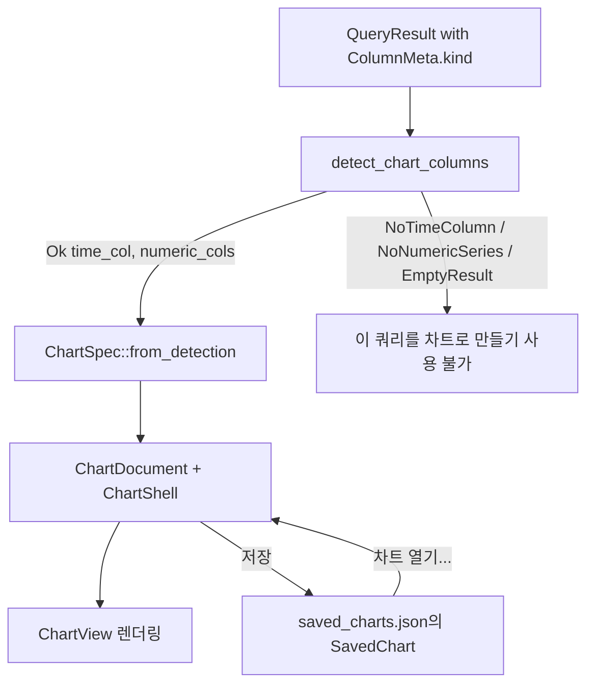

# DBFlux 차트

DBFlux는 쿼리 결과를 차트로 바꿀 수 있습니다. 차트 엔진은 완전히 드라이버에
독립적입니다: 모든 드라이버가 채우는 구조화된 열 메타데이터만 검사할 뿐,
드라이버 식별자나 데이터베이스 고유의 타입 이름 문자열은 절대 보지 않습니다.
이 문서는 지원되는 차트 유형, 엔진이 축을 자동으로 감지하는 방식, 차트가
저장되는 방식, UI에서 차트를 만드는 방법을 설명합니다.

대시보드(공유 시간 범위를 갖는 저장된 차트들의 그리드), 시각화 저장소
테이블(`viz_*`), 그리고 업스트림 대시보드를 가져오거나 탐색하기 위한
드라이버 연동 지점에 대해서는 [`DASHBOARDS.md`](./DASHBOARDS.md)를
참조하세요.

## 개요

차트 엔진은 `dbflux_components` 크레이트의 `crates/dbflux_components/src/chart/` 아래에
있습니다. 이 크레이트의 `mod.rs`는 전체 파이프라인을 설명합니다:

1. `detect` — `ColumnKind` 의미 체계만을 사용해 `QueryResult`에서 적합한 열을 자동으로
   감지합니다.
2. `spec` — 차트 및 시리즈 명세 타입과, 감지 기반 및 수동 열 선택을 위한 생성자를
   제공합니다.
3. `decimate` — 대규모 데이터 집합에서 그리기를 빠르게 유지하기 위한 LTTB
   (Largest-Triangle-Three-Buckets) 다운샘플링입니다.
4. `axis` — 숫자 축과 시간 축의 눈금 생성 및 레이블 형식화입니다.
5. `legend` — 범례 행을 위한 요소 팩토리입니다.
6. `engine` — 차트 상태를 소유하고 캔버스를 렌더링하는 GPUI 엔터티인 `ChartView`입니다.

독립형 차트 문서 UI는 `crates/dbflux_ui_document/src/chart_document/`(`mod.rs`, `render.rs`,
`pane.rs`)에 있습니다. `ChartDocument`는 쿼리, 연결, 차트 명세, `ChartShell`을 소유하며,
`crates/dbflux_components/src/result_panel/`의 공유 `ResultPanel` 크롬을 통해 렌더링을
호스팅합니다.

## 차트 타입

차트 종류는 `crates/dbflux_components/src/chart/spec.rs`의 `ChartKind` 열거형으로
정의됩니다:

| 변형 | 설명 |
|---------|-------------|
| `Line` | 선 차트. 기본 종류(`#[default]`)이며, 모든 `ChartSpec` 생성자가 선택하는 종류이기도 합니다. |
| `Bar` | 막대 차트. |
| `Scatter` | 산점도 차트. |
| `Area` | 채워진 선 차트; 시리즈 선과 기준선 사이의 영역이 음영 처리됩니다. Line의 기하 구조와 호버 동작을 공유합니다. |
| `StackedBar` | 누적 세로 막대. 각 X 위치마다 시리즈별로 하나의 막대가 표시되며, 나란히 그룹화되는 대신 누적으로 쌓입니다. 시리즈는 X 값 기준으로 정렬되며, 어떤 X에 값이 없는 시리즈는 그 막대에 아무것도 더하지 않습니다. Y축은 렌더 시점에 0부터 최대 스택 합계까지로 다시 스케일링되며, 눈금 레이블도 같은 범위를 사용합니다. |
| `Pie` | 파이 차트. X/Y 축이 없으며, 표시되는 각 시리즈가 해당 시리즈의 Y 값 합계에 비례하는 크기의 부채꼴 하나가 됩니다. |

`ChartKind`는 `ChartSpec.kind` 필드에 `#[serde(default)]` 의미 체계를 두고 있으므로,
`kind` 필드 이전에 직렬화된 차트 명세는 `Line`으로 역직렬화됩니다.

## ColumnKind와 축 자동 감지

### ColumnKind

자동 감지는 `crates/dbflux_core/src/query/types.rs`에 정의된 `ColumnKind` 열거형에 의해
전적으로 수행됩니다:

| 변형 | 의미 |
|---------|---------|
| `Timestamp` | 날짜/시간 또는 타임스탬프 열입니다. |
| `Float` | 부동 소수점 숫자 열입니다. |
| `Integer` | 정수 숫자 열입니다. |
| `Text` | 텍스트/문자열 열입니다. |
| `Unknown` | 드라이버가 이 열을 분류하지 못했습니다. |

각 드라이버는 반환하는 모든 열에 `ColumnMeta::kind`를 설정할 책임이 있습니다(`AGENTS.md`의
"Adding a New Driver" 규칙 참고). `Unknown`으로 남은 열은 차트 축이나 시리즈로 사용되지
않습니다.

### 자동 감지 규칙

`crates/dbflux_components/src/chart/detect.rs`의 `detect_chart_columns`는 `QueryResult`에
다음 규칙을 순서대로 적용합니다:

1. 결과의 행이 0개이면 `EmptyResult`를 반환합니다.
2. `kind == Timestamp`인 가장 왼쪽 열을 X축으로 선택합니다. 없으면 `NoTimeColumn`을
   반환합니다.
3. `kind == Float` 또는 `kind == Integer`인 나머지 모든 열을 열 순서대로 수집하여 숫자 Y
   시리즈로 삼습니다. 남은 열이 없으면 `NoNumericSeries`를 반환합니다.
4. 그렇지 않으면 `Ok { time_col, numeric_cols }`를 반환합니다.

그 결과가 `ChartDetection` 열거형이며, 변형은 `Ok`, `NoTimeColumn`, `NoNumericSeries`,
`EmptyResult`입니다.

감지는 모든 숫자 열을 보고하며 Y 선택기에도 모두 나열됩니다. 사용자가 선택하기 전에는
`default_series_columns`가 측정값만 그립니다. 기본 키와 행을 따라 계속 증가하거나 감소하는
정수 열은 테이블 자체 순서의 키처럼 보이므로 제외하고, 부동소수점 열이 있으면 그것을
우선합니다. 계속 증가하는 정수가 유일한 숫자 열이면 그래도 그리고, 기본 키만 있는 결과는 Y 열을
선택할 때까지 아무것도 그리지 않습니다.

시간 열이 없으면 X축은 첫 번째 숫자 열을 사용하고, Y 열을 선택하면 숫자 축 위에 차트가
그려집니다. 차트를 그릴 수 없는 동안에는 차트 영역에 이유와 다음 단계가 표시됩니다. Y 열 선택,
숫자 열을 반환하도록 쿼리 변경, 또는 쿼리가 행을 반환하지 않았거나 실패했다는 안내입니다.

### `type_name`과 드라이버 ID를 검사하지 않는 이유

`detect.rs`의 모듈 수준 문서는 감지 모듈이 쿼리-결과 모델과 차트 엔진 사이의 경계이며,
`type_name` 문자열이나 드라이버 식별자가 아니라 `ColumnKind` 값을 검사한다고 명시합니다.
`detect_chart_columns` 함수는 `column.kind`만 읽으며, `column.type_name`, `column.name`,
드라이버 ID는 절대 읽지 않습니다. 이를 통해 엔진은 특정 드라이버에서 완전히 분리된 상태를
유지하며, `AGENTS.md`의 드라이버/UI 분리 규칙과 일치합니다: 드라이버는 올바른 `ColumnKind`로
열을 분류하는 것만으로 자신의 열을 차트화 가능하게 만듭니다.

`Unknown`은 `Timestamp`도 `Float`/`Integer`도 아니므로, 분류되지 않은 열은 자동 감지된 X축도
자동 감지된 시리즈도 될 수 없습니다. 이는 의도된 설계입니다: 엔진이 타입 문자열로 추측하게
두는 대신 드라이버가 열을 분류하도록 강제합니다.

### 축 종류 추론

`ChartSpec`이 만들어질 때 X축 종류는 X 열의 `ColumnKind`에서 추론됩니다: `Timestamp`는
`AxisKind::Time`(눈금이 날짜/시간으로 형식화됨)으로, 그 외의 모든 값은
`AxisKind::Numeric`(십진 눈금)으로 매핑됩니다. `AxisSpec.unit` 필드는 현재 항상 `None`이며,
향후 드라이버가 제공할 단위 메타데이터를 위한 하위 호환성 확장 지점입니다.

### 숫자 값 추출

엔진이 셀에서 숫자 값을 추출할 때(`engine.rs`의 `extract_f64`), 여러 `Value` 형태를
처리합니다:

- `Value::Int` → `f64`로 캐스팅됩니다.
- `Value::Float` → 유한한 값이면 그대로 사용되며, 유한하지 않은 값은 버려집니다.
- `Value::Decimal` (정밀도를 보존하기 위해 문자열로 저장됨) → `f64`로 손실 있이 파싱되며,
  유한하지 않거나 파싱할 수 없는 값은 버려집니다. `NUMERIC`/`DECIMAL` 열을
  `ColumnKind::Float`로 분류하는 드라이버(예: PostgreSQL `NUMERIC`, MSSQL `DECIMAL`)는 이
  경로를 통과합니다.
- `Value::Bool` → `true`는 `1.0`으로, `false`는 `0.0`으로 매핑되므로, 일부 드라이버가
  `Integer`로 분류하는 `BIT`/`BOOLEAN` 열(예: MSSQL `BIT`)도 계속 그릴 수 있습니다.
- `Value::Text`는 RFC 3339 타임스탬프로서 시간 축에 한해서만 파싱됩니다.
- `Value::Null`과 그 외 모든 형태는 값을 산출하지 않습니다.

## 저장된 차트

영속화되는 차트는 `crates/dbflux_components/src/saved_chart.rs`에 정의된 `SavedChart`
레코드입니다. 저장된 차트는 `SavedChartsRepository`를 통해 통합 SQLite 데이터베이스 —
`viz_saved_charts` 테이블과 관련 `viz_saved_chart_*` 테이블 — 에 저장되며, 메모리 내 캐시는
`SavedChartManager`(`crates/dbflux_ui_base/src/saved_chart_manager.rs`)가 관리합니다. 쓰기는
먼저 리포지토리로 이동하며, 캐시는 성공한 경우에만 갱신됩니다.

`SavedChart`는 다음을 영속화합니다:

- `id`, `name`, `profile_id` — 식별자, 표시 이름, 소유 연결 프로필.
- `source` — `SavedChartSource`로, `Query { query }`(`ChartDocument` 내부에서 실행되는
  쿼리 문자열) 또는 `Collection { collection_ref,
  time_window }`(컬렉션 탐색 소스) 중 하나입니다.
- `context`: `Query` 소스가 실행되는 위치인 `SavedChartContext`. [저장](#저장)을 참조하세요.
- `chart_spec`과 `bindings` — 전체 렌더링 구성(`ChartSpec`과 `BindingSpec`).
- `time_range_preset`, `refresh_policy`, `created_at`, `updated_at`.

쿼리 문자열(또는 컬렉션 참조)만 영속화되며, 원시 결과 데이터는 절대 저장되지 않습니다.

### 저장된 차트 열기

`Workspace::open_saved_chart`(`crates/dbflux_ui/src/ui/views/workspace/actions.rs`)는 소스
타입에 따라 라우팅합니다:

- `Query` 소스는 `ChartDocument::from_saved`를 통해 독립형 `ChartDocument`를 엽니다.
  `from_saved`와 `validate_saved_source`는 `Collection` 소스를 거부하며, 워크스페이스는
  엔터티를 할당하기 전에 소스를 검증합니다.
- `Collection` 소스는 `ChartDocument`를 열지 않으며, `open_collection_document`를 통해
  기반 `DataDocument`를 차트 모드로 다시 엽니다.

### 중복 제거

열린 차트 문서는 `crates/dbflux_ui_document/src/dedup.rs`의
`DocumentKey::Chart { saved_chart_id: Uuid }` 변형을 통해 중복 제거됩니다. 저장된 차트를
열기 전에 `open_saved_chart`는 `tab_manager.find_by_key(&DocumentKey::Chart { ... })`를
호출하여 중복을 열지 않고 기존 탭을 활성화합니다. "이 쿼리를 차트로 만들기"("Chart this
query") 액션으로 만든 차트 문서는 아직 저장된 ID에 연결되지 않았으므로, 저장되기 전까지는
중복 제거되지 않습니다.

## UI에서 차트 만들기

네 가지 진입점이 있습니다.

<picture>
  <source media="(prefers-color-scheme: dark)" srcset="../images/charts/chart-view-dark.webp">
  
</picture>

### 쿼리 편집기의 차트 버튼

표 형태의 결과를 만드는 모든 쿼리는 차트로 나타낼 수 있습니다. 쿼리 편집기 도구 모음에서 차트 버튼(도구 설명: "현재 쿼리를 차트 문서에서 열기")을 클릭하면 현재 쿼리가 차트 문서로 열립니다.

차트는 실행과 같은 것을 실행합니다. 선택 영역이 있으면 그것을, 없으면 커서 아래의 문을 편집기와 같은 데이터베이스와 스키마에서 같은 행 제한으로 실행하므로, `SELECT *`는 실행과 같은 행을 읽습니다. 제한으로 잘리면 알림이 표시되고 도구 모음의 점 개수에 "행 제한 도달"이 표시됩니다.

차트는 열 때와 새로 고칠 때마다 쿼리를 자동으로 실행하므로, 데이터를 읽는 문 하나만 받습니다. 저장된 차트와 대시보드 패널을 포함한 모든 실행에서, 쿼리가 작성된 언어를 기준으로 이를 확인합니다. 드라이버에 쿼리 모드가 있으면 그 모드의 언어(CloudWatch 연결의 기본값은 Logs Insights)를, 없으면 연결의 언어를 사용합니다. 언어에 쿼리 분류기가 있으면(SQL, MongoDB, Redis, 자체 언어를 분류하는 드라이버) 분류기가, 없으면 드라이버의 위험 검사가 판단합니다. 편집기에서는 거부된 문이나 트랜잭션 경계에 알림이 표시되고 차트가 열리지 않습니다. 열려 있는 차트가 거부되면 차트 영역에 이유가 표시되며, 차트를 저장한 뒤 연결 프로필이 읽기 전용으로 바뀐 경우도 마찬가지입니다. 이때 차트 탭은 자동 새로 고침을 멈춥니다. 대시보드 패널은 알림을 한 번만 표시하고 이유를 보여 주며, 대시보드는 다른 패널을 계속 새로 고칩니다.

### 이 쿼리를 차트로 만들기(Chart this query)

데이터 그리드의 상황에 맞는 메뉴는 "이 쿼리를 차트로 만들기"("Chart this query") 항목을
제공합니다. 이 항목은 `crates/dbflux_ui_document/src/data_grid_panel/context_menu/mod.rs`의
`can_chart_from_context_menu`에 의해 게이트되며, 다음 둘 모두를 요구합니다:

1. 패널의 소스가 비어 있지 않은 원본 쿼리를 가진 `QueryResult`이고
2. 현재 결과에 대한 `detect_chart_columns`가 `Ok`를 반환합니다.

항목을 선택하면 `Workspace::open_chart_from_query`가 호출되어, 쿼리와 연결로 시드된
`ChartDocument::new`를 구성하고, `ChartDocument::into_pane`을 통해 `PaneHandle`로 감싸고,
새 탭으로 엽니다. 비어 있지 않은 쿼리가 있으면 문서가 첫 렌더링 시 자동 실행됩니다.

쿼리 편집기의 결과에서 열면 차트는 편집기가 이후 다른 곳으로 옮겨 갔더라도 그 결과가 나온
데이터베이스에서 실행되고, 데이터 문서에서 열면 그 문서의 데이터베이스에서 실행됩니다.

### 차트 열기...

"차트 열기…"("Open chart…") 명령은 활성 프로필에 대해 저장된 차트를 나열하고
(`build_saved_chart_palette_items`로 구축), 앞서 설명한 대로 `open_saved_chart`를 통해
선택한 차트를 엽니다.

차트는 연결 프로필별로 저장할 수 있습니다. 저장된 차트를 다시 열려면 명령 팔레트에서 **차트 열기…**(`OpenSavedChart`)를 실행합니다. 현재 프로필의 저장된 차트를 퍼지(fuzzy) 오버레이에 표시합니다.

### 시계열 테이블과 컬렉션

드라이버가 시계열로 선언한 테이블이나 컬렉션(`ObjectFacet::TimeSeries`: InfluxDB
measurement, 또는 PostgreSQL의 TimescaleDB hypertable)을 열면, 데이터 그리드가 쿼리 결과와 같은 Data, Chart, JSON 뷰를 제공합니다.
`detect_chart_columns`가 `Ok`를 반환하면 첫 페이지가 차트로 열리며, 축은
`default_bindings_for_time_series`로 미리 설정됩니다(X는 시간, Y는 첫 번째 숫자 열,
그룹은 첫 번째 `Text` 열). hypertable의 시간 차원처럼 드라이버가 지정한 시간 열이
결과에 있으면 그 열이 X에 놓이고, 없으면 첫 번째 타임스탬프 열이 놓입니다. 그룹은 해당 열의 서로 다른 값마다 선을 하나씩 그리고
그 값으로 레이블을 붙이므로, `host` 같은 태그는 호스트마다 자기 선을 갖습니다.
축 막대에서 그룹을 고를 때도 마찬가지입니다. 기본 그룹은 결과에서 그 열의 서로 다른 값이
12개 이하일 때만 적용되며(`DEFAULT_GROUP_MAX_VALUES`), 그렇지 않으면 차트는 그룹 없이
시작합니다. 축 막대에서 고른 그룹에는 이 제한이 없습니다. Data 뷰는 다른 컬렉션이 사용하는 문서 트리 대신 그리드에
행을 표시합니다. 수동, 자동, 페이지 이동 등 어떤 새로 고침이든 사용자가 고른 뷰를
유지하며, 새 페이지를 더 이상 차트로 그릴 수 없을 때만 Data로 돌아갑니다.

<picture>
  <source media="(prefers-color-scheme: dark)" srcset="../images/charts/hypertable-dark.webp">
  
</picture>

도구 모음과 상태 표시줄은 드라이버가 실제로 실행하는 쿼리로 이 조회를 표시합니다.
이 쿼리는 `QueryGenerator::collection_browse_query`에서 가져오므로 레이블은 연결
자체의 쿼리 언어로 작성됩니다. 이 메서드를 구현하지 않은 드라이버는 일반 레이블을
유지합니다.

### Escape로 닫기

`Escape`는 누를 때마다 한 단계씩 동작합니다. 열려 있는 축 선택기, 팝오버 또는 저장 프롬프트, 강조된 점, 통계 패널 순서입니다. 텍스트 필드는 자신의 `Escape`를 유지하며, 누르면 키보드만 필드에서 빠집니다. 더 닫을 것이 없으면 다음과 같이 동작합니다.

- 차트 탭은 일반 닫기 경로로 닫히고, 탭을 연 탭이 아직 열려 있으면 그 탭으로, 아니면 다음 탭으로 돌아갑니다. 탭의 닫기 버튼과 닫기 단축키는 평소의 다음 탭을 유지합니다. 어떻게 닫든 진행 중인 실행은 취소됩니다.
- 결과의 차트 보기는 들어오기 전의 보기나 첫 번째 보기로 돌아가고 키보드는 결과에 놓입니다.
- 대시보드의 차트 패널은 패널에서 나가며 대시보드는 열린 채로 유지됩니다.
- 표 + 차트에서는 `Escape`가 표에 남습니다. 그리드 위의 차트는 접을 상태가 없는 결과 보기입니다.

차트 탭은 다시 열 수 없으므로, 닫으면 그 탭에만 있는 것이 사라집니다. 열거나 저장한 이후 변경한 열, 차트 유형, Y 배율, 선택기에서 바꾼 메트릭, 인스턴스 메트릭 차트가 수집한 샘플이 그렇습니다. 이 중 하나라도 있으면 첫 번째 `Escape`는 경고하고 두 번째가 닫습니다. 기본 설정 그대로인 차트는 쿼리나 저장 목록에서 다시 열 수 있으므로 바로 닫힙니다. 시간 범위, 새로 고침 간격, 숨긴 시리즈는 저장에도 포함되지 않으므로 계산하지 않습니다. 탭의 닫기 버튼이나 닫기 단축키는 묻지 않습니다.

### 저장

`ChartDocument` 내부에서 저장 도구 모음 버튼은 이름 입력 프롬프트를 연 뒤 `confirm_save`를
호출하며, 이는 선택한 열, 차트 유형, Y 배율을 포함해 차트가 지금 보여 주는 것을 유지하고 앱
상태의 `saved_charts` 관리자에 `SavedChart`를 업서트합니다. 저장된 차트는 그 설정으로 다시
열립니다. 저장 시 기존 `saved_chart_id`가 있으면 재사용하여 레코드가 중복 생성되지 않고
덮어써지도록 합니다.

저장하면 차트가 실행되는 위치가 현재 실행 컨텍스트에서 함께 저장됩니다. 데이터베이스, 스키마,
컨테이너, 대상(CloudWatch 로그 그룹 등), 쿼리 모드입니다. 편집기에서 연 차트는 편집기의 값을,
결과의 Chart 보기에서 저장한 차트는 그 결과가 실행된 위치를 가집니다. 이 값들은 함께 저장되는 쿼리와
같은 이름 정보이며 `viz_saved_charts`의 `context_*` 열과 `viz_saved_chart_context_targets`에
저장됩니다. 차트가 프로필을 가리키므로 연결 ID는 저장하지 않고, 차트에 자체 범위가 있으므로 시간
경계도 저장하지 않습니다. 고정된 데이터베이스 하나만 있는 드라이버(SQLite, Turso, CloudWatch 등)는
데이터베이스를 저장하지 않습니다. 이름 변경, 다시 저장, 복제 시 컨텍스트가 유지됩니다.

다시 연 차트나 대시보드 패널은 사이드바에서 무엇을 선택했든 그 위치에서 실행됩니다. 데이터베이스마다
연결을 쓰는 드라이버에서는 차트가 필요한 연결을 직접 엽니다. 연결 목록에 없는 저장된 데이터베이스는
이름을 밝히는 메시지와 함께 차트를 멈추며, 다른 데이터베이스에서 실행되지 않습니다. 이 검사는 연결이
마지막으로 연결되거나 새로 고쳐졌을 때의 목록을 읽으므로, 그 후에 만든 데이터베이스는 새로 고칠 때까지
없는 것으로 간주됩니다. 열 수 없는 데이터베이스도 차트에 이름이 표시되며 차트의 자동 새로 고침이
멈춥니다. 대시보드 타이머는 다시 시도하지 않고, 직접 새로 고치면 다시 시도합니다. 더 이상 없는 로그 그룹은 드라이버 자체의 오류가 차트 영역에 표시됩니다. 이 기능
이전에 저장한 차트에는 컨텍스트가 없습니다. 데이터베이스를 보내지 않고 연결 자체의 데이터베이스에서
실행되므로 테이블 이름을 한정해야 하며, 다시 저장해도 추가되지 않습니다. 저장된 쿼리 차트와 대시보드
패널에는 편집기 행 제한이 적용되며, 메트릭과 인스턴스 메트릭 소스에는 적용되지 않습니다.

차트는 편집기가 실행되는 세션을 옮기지 않습니다. 현재 데이터베이스를 한 세션에 유지하는 MySQL,
MariaDB, SQL Server에서는 차트가 첫 실행 때 여는 자체 연결에서 실행됩니다(서버 연결이 하나 늘어납니다).
따라서 편집기의 임시 테이블, 세션 변수, 커밋되지 않은 변경 사항을 볼 수 없습니다. DuckDB와 Turso에서는
편집기에 자체 세션이 있어 효과가 같으며, 편집기에 열린 트랜잭션이 있을 때 연 차트는 영역 위에 한 줄로 이를
알립니다. 이 줄은 차트를 연 시점을 설명하며 나중에 편집기가 커밋해도 남아 있습니다. 앱은 다른 드라이버의 열린
트랜잭션을 추적하지 않으므로 이 줄이 표시되지 않습니다. PostgreSQL과 Redshift에서는 차트가 해당
데이터베이스의 연결에서 실행되며 그 데이터베이스의 편집기와 공유하므로, 트랜잭션 중에 연 차트는 그 안에서
실행되어 편집기가 커밋하거나 롤백할 때까지 해당 행을 볼 수 있습니다.

## 제한 사항

이 제한 사항은 가정이 아니라 현재 코드에 기반합니다:

- 자동 감지는 X축을 선택하기 위해 최소 하나의 `Timestamp` 열을 요구합니다; 없으면
  `detect_chart_columns`가 `NoTimeColumn`을 반환하고 "이 쿼리를 차트로 만들기"를 사용할 수
  없습니다. 편집기의 차트 버튼으로 연 차트는 대신 Y 열을 요청하고 숫자 X 열에 대해 그리며,
  이 X 열은 `AxisKind::Numeric` 축으로 분류됩니다.
- `ColumnKind::Unknown`인 열은 자동 감지에서 완전히 제외됩니다.
- 차트는 쿼리 분류기가 쓰기로 판단한 것을 거부하므로 그 분류기만큼만 정확합니다. InfluxDB에서
  `SELECT ... INTO`와 Flux `to()`는 쓰기를 수행하지만 읽기로 판단되어 걸러지지 않습니다.
- `Collection` 소스의 저장된 차트는 `ChartDocument`로 열 수 없으며, 대신 기반
  `DataDocument`를 차트 모드로 다시 엽니다. `ChartDocument::from_saved`에 `Collection`
  소스를 전달하면 오류가 반환됩니다.
- 이 버전에서 `AxisSpec.unit`은 항상 `None`이며, 드라이버가 아직 단위 메타데이터를
  제공하지 않습니다.
- 모든 `ChartSpec` 생성자(`from_detection`, `from_bindings`, `from_manual_selection`)는
  `kind = ChartKind::Line`인 명세를 만들며, 다른 차트 종류는 생성 후에 선택됩니다.
- 시리즈 데시메이션은 기본값이 10,000포인트인 LTTB 임계값을 사용합니다
  (`default_decimation_threshold`).
