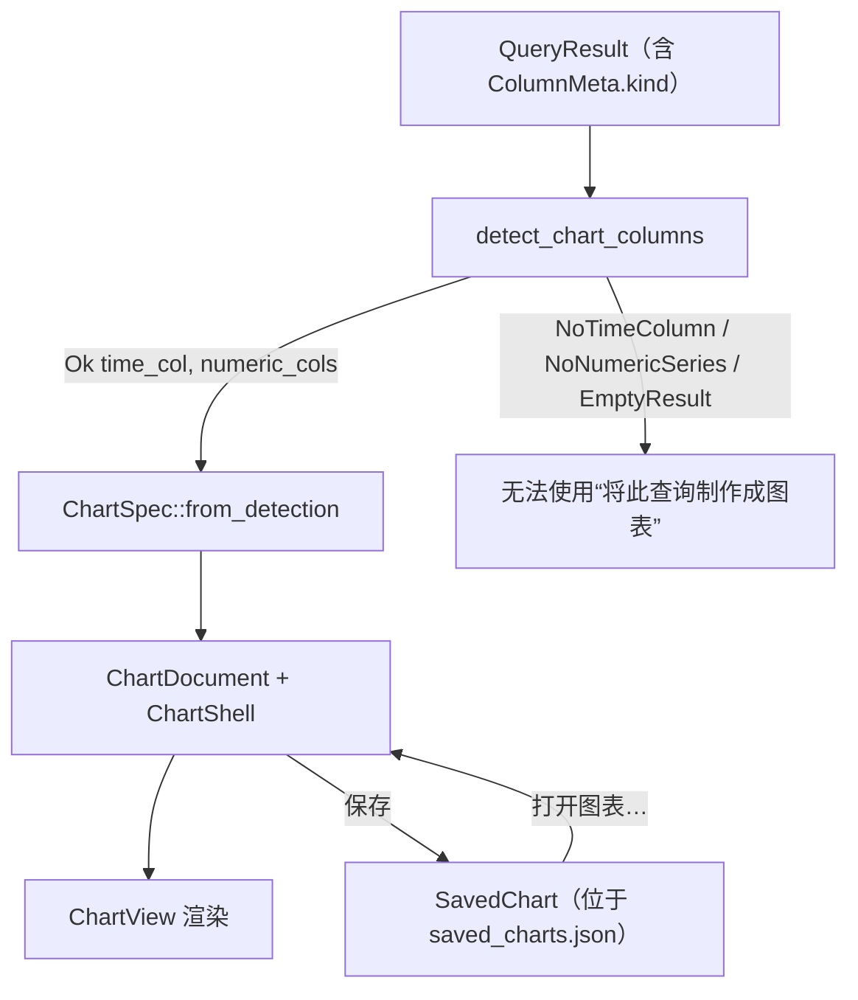

# DBFlux 图表

DBFlux 可以将查询结果转换为图表。图表引擎完全不依赖特定驱动程序：它只检查每个驱动程序都会填充的结构化列元数据，而不会查看驱动程序标识符或数据库特定的类型名字符串。本文档介绍受支持的图表类型、引擎如何自动检测坐标轴、图表如何持久化存储，以及如何从界面创建图表。

关于仪表盘（由共享时间范围的已保存图表组成的网格）、可视化存储表（`viz_*`），以及用于导入/浏览上游仪表盘的驱动程序接缝，请参阅 [`DASHBOARDS.md`](./DASHBOARDS.md)。

## 概述

图表引擎位于 `dbflux_components` crate 的 `crates/dbflux_components/src/chart/` 目录下。其 `mod.rs` 描述了完整的处理流程：

1. `detect` —— 仅依据 `ColumnKind` 的语义，从 `QueryResult` 中自动检测合适的列。
2. `spec` —— 图表与序列的规格类型，以及基于检测结果或手动选择列的构造函数。
3. `decimate` —— LTTB（Largest-Triangle-Three-Buckets）降采样，以在大数据集上保持绘制流畅。
4. `axis` —— 数值轴与时间轴的刻度生成与标签格式化。
5. `legend` —— 图例行中的元素工厂。
6. `engine` —— `ChartView`，即持有图表状态并负责绘制画布的 GPUI 实体。

独立的图表文档界面位于 `crates/dbflux_ui_document/src/chart_document/`（`mod.rs`、`render.rs`、`pane.rs`）。一个 `ChartDocument` 持有一个查询、一个连接、一份图表规格，以及一个 `ChartShell`，并通过 `crates/dbflux_components/src/result_panel/` 中的共享 `ResultPanel` 框架完成其渲染。

## 图表类型

图表类型由 `crates/dbflux_components/src/chart/spec.rs` 中的 `ChartKind` 枚举定义：

| 变体 | 说明 |
| --- | --- |
| `Line` | 折线图。默认类型（`#[default]`）；也是每个 `ChartSpec` 构造函数所选择的类型。 |
| `Bar` | 柱状图。 |
| `Scatter` | 散点图。 |
| `Area` | 填充式折线图；系列线与基线之间的区域会被填充阴影。其几何形状与悬停行为和折线图相同。 |
| `StackedBar` | 堆叠柱状图。每个 X 位置为每个系列显示一根柱子，按累加方式堆叠，而非并排分组。各系列按 X 值对齐：某个系列在某个 X 上没有值时，不会为该柱子增加任何部分。Y 轴在渲染时重新缩放为从零到最大堆叠总和，刻度标签也使用同一范围。 |
| `Pie` | 饼图。没有 X/Y 轴；每个可见系列成为一块扇形，其大小由该系列 Y 值之和决定。 |

`ChartKind` 在所属 `ChartSpec.kind` 字段上带有 `#[serde(default)]` 语义，因此早于 `kind` 字段出现的序列化图表规格在反序列化时会回退为 `Line`。

## ColumnKind 与坐标轴自动检测

### ColumnKind

自动检测完全由 `crates/dbflux_core/src/query/types.rs` 中定义的 `ColumnKind` 枚举驱动：

| 变体 | 含义 |
| --- | --- |
| `Timestamp` | 日期/时间或时间戳列。 |
| `Float` | 浮点数值列。 |
| `Integer` | 整数数值列。 |
| `Text` | 文本/字符串列。 |
| `Unknown` | 驱动程序无法对该列进行分类。 |

每个驱动程序负责为其返回的每一列设置 `ColumnMeta::kind`（参见 `AGENTS.md` 中的“新增驱动程序”规则）。保留为 `Unknown` 的列永远不会被用作图表的坐标轴或序列。

### 自动检测规则

`crates/dbflux_components/src/chart/detect.rs` 中的 `detect_chart_columns` 会按以下顺序对 `QueryResult` 应用这些规则：

1. 如果结果包含零行，返回 `EmptyResult`。
2. 选取最左侧 `kind == Timestamp` 的列作为 X 轴。若不存在这样的列，返回 `NoTimeColumn`。
3. 按列顺序收集所有其他 `kind == Float` 或 `kind == Integer` 的列，作为数值型 Y 序列。若没有剩余列，返回 `NoNumericSeries`。
4. 否则返回 `Ok { time_col, numeric_cols }`。

上述结果的类型为 `ChartDetection` 枚举，其变体包括 `Ok`、`NoTimeColumn`、`NoNumericSeries` 和 `EmptyResult`。

检测会报告所有数值列，Y 选择器也会全部列出。用户选择之前，`default_series_columns` 只绘制度量列：排除主键和在各行中严格递增或递减的整数列（表自身顺序中的键就是这样），并在有浮点列时优先使用浮点列。递增整数是唯一的数值列时仍会绘制；只有主键的结果在选择 Y 列之前不绘制任何内容。

没有时间列时，X 轴默认使用第一个数值列，选择 Y 列后图表绘制在数值轴上。图表无法绘制时，图表区域会说明原因和下一步操作：选择 Y 列、修改查询以返回数值列，或说明查询未返回行或已失败。

### 为何从不检查 `type_name` 与驱动程序标识符

`detect.rs` 的模块级文档说明，检测模块是查询结果模型与图表引擎之间的边界，它检查的是 `ColumnKind` 值——而非 `type_name` 字符串或驱动程序标识符。`detect_chart_columns` 函数只读取 `column.kind`；它从不读取 `column.type_name`、`column.name` 或任何驱动程序 ID。这让引擎与具体驱动程序完全解耦，符合 `AGENTS.md` 中“驱动程序/界面解耦”的规则：驱动程序只需用正确的 `ColumnKind` 对列进行分类，就能使其可用于绘制图表。

由于 `Unknown` 既非 `Timestamp`，也非 `Float`/`Integer`，未分类的列既不能成为自动检测出的 X 轴，也不能成为自动检测出的序列。这是有意为之：它迫使驱动程序对列进行分类，而不是让引擎从类型字符串中猜测。

### 坐标轴类型推断

构建 `ChartSpec` 时，X 轴的类型由 X 列的 `ColumnKind` 推断得出：`Timestamp` 映射为 `AxisKind::Time`（刻度格式化为日期/时间），其他情况映射为 `AxisKind::Numeric`（十进制刻度）。`AxisSpec.unit` 字段目前始终为 `None`；它是为将来由驱动程序提供的单位元数据预留的向前兼容接缝。

### 数值提取

当引擎从单元格中提取数值时（`engine.rs` 中的 `extract_f64`），它会处理多种 `Value` 形态：

- `Value::Int` → 转换为 `f64`。
- `Value::Float` → 在有限时直接使用；非有限值会被丢弃。
- `Value::Decimal`（以字符串形式存储以保留精度）→ 有损解析为 `f64`，丢弃非有限或无法解析的值。将 `NUMERIC`/`DECIMAL` 列归类为 `ColumnKind::Float` 的驱动程序（例如 PostgreSQL 的 `NUMERIC`、MSSQL 的 `DECIMAL`）会走这条路径。
- `Value::Bool` → `true` 映射为 `1.0`，`false` 映射为 `0.0`，因此某些驱动程序归类为 `Integer` 的 `BIT`/`BOOLEAN` 列（例如 MSSQL 的 `BIT`）仍可绘制。
- `Value::Text` 仅在时间轴上作为 RFC 3339 时间戳进行解析。
- `Value::Null` 以及所有其他形态不产生数值。

## 已保存的图表

一个已持久化的图表是一条 `SavedChart` 记录，定义于 `crates/dbflux_components/src/saved_chart.rs`。已保存的图表通过 `SavedChartsRepository` 存储在统一的 SQLite 数据库中——即 `viz_saved_charts` 表及其相关的 `viz_saved_chart_*` 表——并由 `SavedChartManager`（`crates/dbflux_ui_base/src/saved_chart_manager.rs`）管理内存缓存。写入操作先写入存储库；缓存仅在成功后更新。

`SavedChart` 持久化以下字段：

- `id`、`name`、`profile_id` —— 标识、显示名称，以及所属的「连接配置」。
- `source` —— 一个 `SavedChartSource`，可以是 `Query { query }`（在 `ChartDocument` 中执行的查询字符串），或 `Collection { collection_ref, time_window }`（集合浏览来源）。
- `context`：`Query` 来源的运行位置，即 `SavedChartContext`；参见[保存](#保存)。
- `chart_spec` 与 `bindings` —— 完整的渲染配置（`ChartSpec` 与 `BindingSpec`）。
- `time_range_preset`、`refresh_policy`、`created_at`、`updated_at`。

仅持久化查询字符串（或集合引用）；原始结果数据从不存储。

### 打开已保存的图表

`Workspace::open_saved_chart`（位于 `crates/dbflux_ui/src/ui/views/workspace/actions.rs`）按来源类型分流：

- `Query` 来源通过 `ChartDocument::from_saved` 打开一个独立的 `ChartDocument`。`from_saved` 与 `validate_saved_source` 会拒绝 `Collection` 来源；工作区会在分配实体前先对来源进行校验。
- `Collection` 来源不会打开 `ChartDocument`；它们会通过 `open_collection_document` 以图表模式重新打开底层的 `DataDocument`。

### 去重

已打开的图表文档通过 `crates/dbflux_ui_document/src/dedup.rs` 中的 `DocumentKey::Chart { saved_chart_id: Uuid }` 变体进行去重。在打开已保存的图表前，`open_saved_chart` 会调用 `tab_manager.find_by_key(&DocumentKey::Chart { ... })`，并激活已有的标签页，而不是打开重复的标签页。通过临时性的“将此查询制作成图表”操作创建的图表文档尚未关联到已保存的 ID，因此在保存之前不会被去重。

## 在界面中创建图表

有四个入口。

<picture>
  <source media="(prefers-color-scheme: dark)" srcset="../images/charts/chart-view-dark.webp">
  
</picture>

### 查询编辑器中的图表按钮

任何产生表格化结果的查询都可以绘制成图表。在查询编辑器左边缘的操作栏中点击图表按钮（提示文本为“在图表文档中打开当前查询”），即可在图表文档中打开当前查询。

图表运行的内容与“运行”相同：有选区时运行选区，否则运行光标所在的语句，并使用编辑器所在的数据库和模式以及相同的行数限制，因此 `SELECT *` 读取的行与“运行”相同。被限制截断时会有提示，工具栏的点数也会显示“已达到行数限制”。

图表在打开时和每次刷新时都会自行运行查询，因此只接受一条读取数据的语句。每次运行都会按查询所用的语言检查，包括已保存的图表和仪表板面板：驱动有查询模式时使用该模式的语言（CloudWatch 连接默认为 Logs Insights），否则使用连接的语言。语言有查询分类器时由分类器判断（SQL、MongoDB、Redis 以及自行分类其语言的驱动），否则由驱动的危险检查判断。在编辑器中，被拒绝的语句或事务边界会给出提示，不会打开图表。已打开的图表被拒绝时，会在图表区域显示原因；图表保存后连接配置变为只读时也是如此。此时图表标签页会停止自动刷新；仪表板面板只提示一次并显示原因，仪表板继续刷新其他面板。

### 将此查询制作成图表

数据网格的上下文菜单提供“将此查询制作成图表”项。该项由 `crates/dbflux_ui_document/src/data_grid_panel/context_menu/mod.rs` 中的 `can_chart_from_context_menu` 控制，需要同时满足：

1. 面板的来源是一个带有非空原始查询的 `QueryResult`；且
2. 对当前结果调用 `detect_chart_columns` 返回 `Ok`。

选择该项会调用 `Workspace::open_chart_from_query`，它构造一个以查询和连接为种子的 `ChartDocument::new`，通过 `ChartDocument::into_pane` 将其包装为 `PaneHandle`，并以新标签页形式打开。非空查询会使文档在首次渲染时自动执行。

从查询编辑器的结果打开时，即使编辑器之后已切换，图表也会在该结果所来自的数据库中运行；从数据文档打开时，则在该文档的数据库中运行。

### 打开图表…

“打开图表…”命令会列出当前连接配置的已保存图表（由 `build_saved_chart_palette_items` 构建），并通过上文所述的 `open_saved_chart` 打开所选图表。

图表可以按连接配置保存。要重新打开已保存的图表，请从命令面板执行 **打开图表…**（`OpenSavedChart`），它会以支持模糊搜索的浮层列出当前连接配置下已保存的图表。

### 时间序列表和集合

打开驱动声明为时间序列的表或集合（`ObjectFacet::TimeSeries`：InfluxDB 的 measurement，或 PostgreSQL 上的 TimescaleDB hypertable）时，其数据网格会提供与查询结果相同的 Data、Chart 和 JSON 视图，另加 **Both**，即在网格上方绘制图表。当 `detect_chart_columns` 返回 `Ok` 时，第一页以 Both 形式打开，坐标轴由 `default_bindings_for_time_series` 预设（X 轴为时间，Y 轴为第一个数值列，分组为第一个 `Text` 列）。驱动指定的时间列（例如 hypertable 的时间维度）出现在结果中时放在 X 轴上，否则使用第一个时间戳列。分组会为其列的每个不同值绘制一条线，并以该值作为标签，因此像 `host` 这样的标签会让每台主机拥有自己的线。在坐标轴栏中选择分组时同样如此。只有当该列在结果中的不同值不超过 12 个（`DEFAULT_GROUP_MAX_VALUES`）时才会应用默认分组，否则图表以不分组状态打开。在坐标轴栏中手动选择的分组没有此限制。Data 视图以网格显示各行，而不是其他集合使用的文档树。刷新（无论是手动、自动还是翻页）会保留用户选择的视图，只有当新的一页无法再绘制图表时才回退到 Data。

<picture>
  <source media="(prefers-color-scheme: dark)" srcset="../images/charts/hypertable-dark.webp">
  
</picture>

工具栏和状态栏使用驱动程序实际运行的查询来命名这次浏览，该查询取自 `QueryGenerator::collection_browse_query`，因此标签以连接自身的查询语言书写。未实现该方法的驱动程序保留通用标签。

### 用 Escape 关闭

`Escape` 按层工作，每按一次处理一层：打开的坐标轴选择器、弹出面板或保存提示，然后是高亮点，然后是统计侧栏。文本框保留自己的 `Escape`，按键只会让键盘离开文本框。没有可关闭的内容时：

- 图表标签页通过正常的关闭流程关闭，并返回打开它的标签页（如果仍然打开），否则转到下一个标签页。标签页的关闭按钮和关闭快捷键保持通常的下一个标签页。任何关闭方式都会取消正在进行的运行。
- 结果的图表视图返回进入前的视图或第一个视图，键盘回到结果中。
- 仪表板中的图表面板退出面板，仪表板保持打开。
- 表格 + 图表视图中 `Escape` 仍归表格；表格上方的图表是结果的一个视图，没有可折叠的状态。

图表标签页无法重新打开，因此关闭会丢弃只有它才有的内容：打开或保存以来更改的列、图表类型、Y 轴刻度、查询和数据库，在选择器中更换的指标，以及实例指标图表收集的样本。存在其中任何一项时，第一次 `Escape` 发出警告，第二次才关闭。仍为默认设置的图表会立即关闭，因为可以从查询或已保存列表重新打开。时间范围、刷新间隔和隐藏的系列不计入，因为保存也不会保留它们。使用标签页的关闭按钮或关闭快捷键不会询问。

### 保存

在 `ChartDocument` 内部，工具栏上的“保存图表”按钮会打开名称提示，然后调用 `confirm_save`；该函数保留图表当前显示的内容（包括选择的列、图表类型和 Y 轴刻度），并将 `SavedChart` 以 upsert 方式写入应用状态的 `saved_charts` 管理器。已保存的图表会以这些设置重新打开。保存时若已存在 `saved_chart_id` 则会复用，因此记录会被覆盖而非重复创建。

保存时会保留图表的运行位置，取自其当前的执行上下文：数据库、模式和容器、目标（例如 CloudWatch 日志组）以及查询模式。从编辑器打开的图表持有编辑器的这些值，从结果的 Chart 视图保存的图表持有该结果的运行位置。它们与一同保存的查询一样只是名称，存放在 `viz_saved_charts` 的 `context_*` 列和 `viz_saved_chart_context_targets` 中。连接 ID 不保存，因为图表指向其配置文件；时间边界也不保存，因为图表有自己的范围。只有一个固定数据库的驱动（SQLite、Turso、CloudWatch 等）不保存数据库。重命名、再次保存和复制都会保留上下文。

重新打开的图表或仪表板面板在该位置运行，无论侧栏选择了什么。在每个数据库一个连接的驱动上，图表会自行打开所需的连接。连接未列出的已保存数据库会使图表停止并显示指明该数据库的消息，不会在其他数据库上运行。此检查读取连接上次连接或刷新时的列表，因此之后创建的数据库在刷新前都算作不存在。无法打开的数据库同样会在图表中被指明，并停止图表的自动刷新；仪表板的定时器不会重试，手动刷新才会重试。已不存在的日志组会在图表区域显示驱动自身的错误。在此功能之前保存的图表没有上下文：它不发送数据库，在连接自身的数据库上运行，因此在“查询”部分选择数据库并保存之前需要限定表名。已保存的查询图表和仪表板面板会应用编辑器的行数限制；指标和实例指标来源不受此限制。

图表不会移动编辑器运行所在的会话。在把当前数据库保存在单个会话上的 MySQL、MariaDB 和 SQL Server 上，图表在自己的连接上运行，该连接在第一个图表运行时打开（会多占用一个服务器连接）。因此它看不到编辑器的临时表、会话变量或未提交的更改，从其标签页或任务面板取消它时也只会停止该图表。在 DuckDB 和 Turso 上，编辑器拥有自己的会话，效果相同；在那里，在编辑器有打开的事务时打开的图表会在其区域上方用一行说明这一点。这一行描述的是图表打开时的情况，之后即使编辑器提交也会保留。应用不跟踪其他驱动上打开的事务，因此它们不显示这一行。在 PostgreSQL 和 Redshift 上，图表在其数据库的连接上运行，与该数据库上的编辑器共用，因此在事务期间打开的图表会在该事务内运行，并能看到这些行，直到编辑器提交或回滚。

### 查询部分

有查询的图表在图表区域上方有一个“查询”部分，默认折叠，以便图表保留空间：折叠时显示数据库和 SQL 的第一行。可通过其按钮或窗格操作打开。打开后包含 SQL 框、数据库选择器和“运行”。指标、实例指标和集合图表没有此部分，仪表板面板也没有，因为其界面由宿主负责：要编辑时请从已保存列表打开图表。已打开的面板会像重新打开时一样采用保存的内容。

输入不会运行任何内容。“运行”、框内的快捷键（`Ctrl+Enter`，macOS 上为 `Cmd+Enter`）和工具栏的刷新会应用框和选择器并运行。定时刷新继续运行上次运行的内容。保存同样会应用并运行，并覆盖同一图表。框中的内容在每次运行时都要通过与任何图表相同的只读检查，因此更改数据的语句即使被保存也不会运行。

选择器出现在拥有多个数据库的驱动上。它列出连接的数据库和“连接的默认数据库”，后者表示未保存数据库，选择它也不会保存任何数据库。连接未列出的已保存数据库仍带标记地留在列表中，以便查看和更改。选择其他数据库会清除属于旧数据库的已保存模式和容器。保存后，所选数据库会像其他已保存数据库一样接受检查。

编辑属于关闭时会丢失的内容，因此第一次按 `Escape` 会发出警告。在框内，`Escape` 先离开框并保留文本。

编辑后，已选的列会按名称跟随到新结果中的位置。如果某列已不存在，图表会回到检测找到的列并加以说明。列按位置保存，因此保存尚无结果的查询时不会保存列，保存时启动的运行会保存它们。如果在该运行结束前重新打开，图表使用检测找到的列。

## 数据点检查器

在表格或集合标签页的图表中（图表视图和“两者”视图），当指针位于某个数据点上，或通过键盘高亮某个数据点时（参见键盘参考中的[图表](KEYBOARD.md#图表)），数据点检查器会停靠在图表右侧。它显示序列、该点的 X 值和 Y 值、该点所来自的行的字段，以及一个 **在树中显示** 按钮。

**在树中显示** 会在表格中选中该行并把键盘交给表格。在图表视图中会切换到表格；“两者”视图会保留表格上方的图表。高亮某个数据点时，结果的表格菜单在 **工具栏** 下提供同样的操作。

查询编辑器结果的图表和图表标签页不记录每个点对应的行，因此不显示数据点检查器。

<picture>
  <source media="(prefers-color-scheme: dark)" srcset="../images/charts/point-inspector-dark.webp">
  
</picture>

## 限制

以下限制基于当前代码，而非假设：

- 自动检测至少需要一个 `Timestamp` 列才能选出 X 轴；若没有，`detect_chart_columns` 会返回 `NoTimeColumn`，且“将此查询制作成图表”不可用。从编辑器的图表按钮打开的图表会改为要求选择 Y 列，并相对于数值 X 列绘制，该列被归类为 `AxisKind::Numeric` 轴。
- 带有 `ColumnKind::Unknown` 的列完全被排除在自动检测之外。
- 图表拒绝查询分类器判定为写入的内容，因此其准确性取决于该分类器。它无法看到存储过程或函数的实际行为，也无法识别 Flux 在此版本之后新增的包。
- 来源为 `Collection` 的已保存图表无法作为 `ChartDocument` 打开；它们会改为以图表模式重新打开底层的 `DataDocument`。将 `Collection` 来源传给 `ChartDocument::from_saved` 会返回错误。
- 在本版本中 `AxisSpec.unit` 始终为 `None`；驱动程序尚未提供单位元数据。
- 每个 `ChartSpec` 构造函数（`from_detection`、`from_bindings`、`from_manual_selection`）生成的规格均为 `kind = ChartKind::Line`；其他图表类型在构造之后选择。
- 序列降采样使用的 LTTB 阈值，其默认值为 10,000 个点（`default_decimation_threshold`）。
